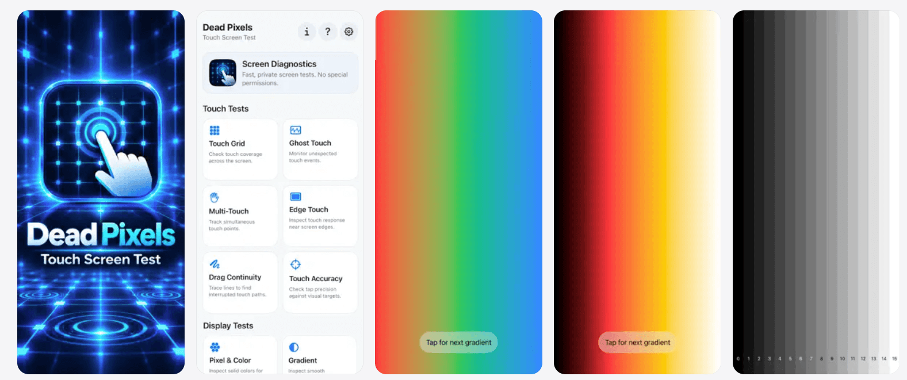

# Dead Pixels: Touch Screen Test

**Test. Detect. Inspect. Stay Informed.**

A simple screen testing app to detect dead pixels, touchscreen issues, and display problems on your device.

[**Download on App Store**](https://apps.apple.com/app/dead-pixels-touch-screen-test/id6835477188) · [**Get it on Google Play**](https://play.google.com/store/apps/details?id=sam.touch.screen.deadpixels)

---

## About the App

Hi everyone! 👋

I'm a solo developer, and I wanted to create a simple app that helps people check their screens for dead pixels, touch issues, and display problems — without complicated tools.

So I built **Dead Pixels: Touch Screen Test**.

The app includes **11 practical screen tests** to help you inspect your display and touchscreen in just a few minutes.

## Key Features

- **Dead Pixel Detection** — Find dead pixels, stuck pixels, and visible display defects.
- **Touchscreen Testing** — Identify unresponsive areas and touchscreen issues.
- **Ghost Touch Detection** — Check for unexpected or unintended touch inputs.
- **Multi-Touch Testing** — Test multiple simultaneous touch points.
- **Screen Edge Testing** — Check touch responsiveness near screen boundaries.
- **Drag & Touch Accuracy** — Inspect dragging behavior and touch precision.
- **Color Display Tests** — Examine screen colors for inconsistencies.
- **Gradient & Grayscale Tests** — Inspect color transitions, brightness, and grayscale.
- **Refresh Rate & FPS** — View screen refresh performance and frame rate.
- **Display Information** — Check useful screen and device display details.
- **Offline Testing** — Run screen tests without an internet connection or account.

## When to Use

Dead Pixels: Touch Screen Test is especially useful for:

- **Buying a Used Phone** — Inspect the screen before purchasing a secondhand device.
- **After Screen Repairs** — Check touchscreen functionality and display quality.
- **Troubleshooting** — Investigate dead pixels, ghost touches, or unresponsive areas.
- **Routine Screen Checks** — Quickly inspect your display whenever needed.

## Download

Dead Pixels: Touch Screen Test is available for **iOS and Android**.

### iOS — App Store
[Download Dead Pixels for iPhone](https://apps.apple.com/app/dead-pixels-touch-screen-test/id6835477188)

### Android — Google Play
[Download Dead Pixels for Android](https://play.google.com/store/apps/details?id=sam.touch.screen.deadpixels)

---

### Test. Detect. Inspect. Stay Informed.

Made with ❤️ by an independent developer.

